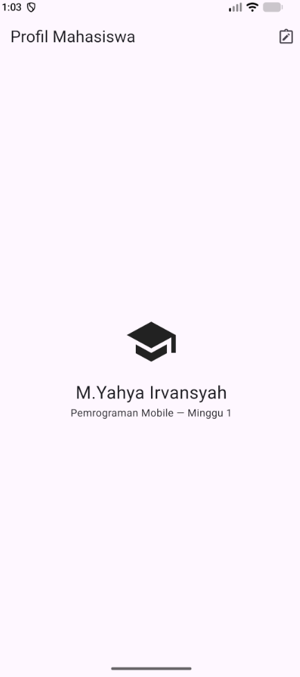
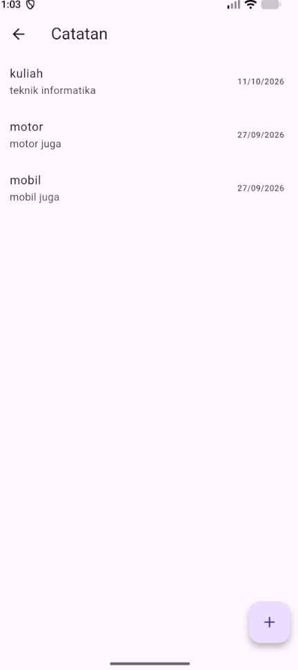

Penyebab utama: interface NoteRepository dan halaman Notes berada di lokasi yang tidak sesuai. Selain itu, routes.dart kosong, UI bergantung pada file widget tambahan, dan pembuka database yang ditambahkan sebelumnya menduplikasi sumber database yang sebenarnya tersedia di project minggu 5.
Perbaikan: memindahkan interface ke domain/repositories/note_repository.dart, mempertahankan entity, model, implementasi repository, dan use case pada lapisan yang tepat, serta merapikan wiring provider di notes_providers.dart.
notes_page.dart kini menangani daftar dan tampilan error langsung dengan widget Flutter bawaan. Alur tambah catatan tetap memuat ulang daftar.
routes.dart dan main.dart kini terhubung melalui named route, tanpa mengubah pintu masuk Notes dari layar profil.
Provider memakai openNotesDb dari sumber yang tersedia di db.dart, melalui dependency path lokal. File database duplikat dan file widget tambahan sebelumnya dihapus.
File target yang belum tersedia: tidak ada. core/providers.dart tersedia dan opsional; routes.dart sebelumnya kosong, sekarang sudah dihubungkan.
Verifikasi: flutter pub get berhasil, flutter analyze melaporkan No issues found, dan flutter test lulus (2 test), termasuk pengujian alur membaca dan menambahkan catatan melalui repository fake. Pengujian widget tidak menjalankan plugin SQLite secara langsung. Versi yang digunakan: Flutter 3.49.0-0.2.pre, Dart 3.14.0-167.0.dev, Riverpod 3.4.3, dan sqflite 2.4.4+1.

lib/
├── core/
│   └── providers.dart                    # opsional, hanya dependency lintas fitur
├── features/
│   ├── authentication/
│   │   ├── presentation/
│   │   │   ├── pages/                    # login, beranda
│   │   │   └── providers/                # auth state/controller dan wiring
│   │   ├── domain/
│   │   │   ├── entities/                 # sesi pengguna
│   │   │   ├── repositories/              # kontrak repository auth
│   │   │   └── usecases/                 # login bila ada orkestrasi/policy
│   │   └── data/
│   │       ├── models/                   # mapping payload/session
│   │       ├── datasources/              # API dan secure storage
│   │       └── repositories/             # implementasi kontrak auth
│   └── announcements/
│       ├── presentation/
│       │   ├── pages/                    # halaman/detail dan daftar jika tersedia
│       │   └── providers/
│       ├── domain/
│       │   ├── entities/
│       │   ├── repositories/
│       │   └── usecases/                 # hanya bila diperlukan aturan bisnis
│       └── data/
│           ├── models/
│           ├── datasources/              # API/FCM
│           └── repositories/
├── main.dart                             # bootstrap Firebase, ProviderScope, router
└── routes.dart                           # opsional; routing aplikasi

Bagian announcements di atas adalah tujuan arsitektur, bukan file yang sudah ada. Kode saat ini menangani notifikasi FCM dan membuka route detail, tetapi belum memuat fitur pengambilan/penyajian daftar pengumuman.

Pemetaan file lama
File saat ini	Tujuan yang disarankan	Keputusan
main.dart	Tetap sebagai bootstrap/composition root dan konfigurasi router. Pindahkan widget AnnouncementPage ke halaman fitur announcements saat halaman itu benar-benar diimplementasikan.	Tetap untuk bootstrap; widget inline dipindah kemudian
auth_repository.dart	Pisahkan kontrak repository dan entitas sesi ke authentication/domain; pindahkan implementasi mock/API ke authentication/data.	Dipecah saat refactor
api_client.dart	authentication/data/datasources/ atau client API bersama jika dipakai lebih dari satu fitur.	Dipindah; tetap menjadi detail Data
token_store.dart	authentication/data/datasources/ untuk secure storage.	Dipindah; jangan dipanggil langsung dari Presentation
auth_provider.dart	authentication/presentation/providers/. Controller sebaiknya menggunakan kontrak/use case, bukan TokenStore.	Dipindah saat refactor; wiring minimal sudah ditambahkan
push_service.dart	announcements/data/datasources/ untuk integrasi FCM/notifikasi lokal; navigasi tetap ditangani router/presentation.	Dipindah atau dipecah saat fitur dirapikan
login_page.dart, home_page.dart, announcement_page.dart	Halaman presentation/pages/ di fitur masing-masing.	File ada tetapi kosong; tidak ada implementasi untuk dipindahkan
widget_test.dart	Perlu diselaraskan dengan UI dan bootstrap aktual.	Test masih berupa template counter

Riverpod dan use case
Saya memperbaiki wiring yang memang rusak: auth_provider.dart merujuk tokenStoreProvider dan authRepositoryProvider yang sebelumnya tidak tersedia. Keduanya sekarang didefinisikan. main.dart juga membungkus aplikasi dengan ProviderScope.

Alur wiring saat ini adalah ProviderScope → authStateProvider → AuthNotifier → authRepositoryProvider/tokenStoreProvider. Ini memperbaiki error analyzer dan tidak menambah package DI. Untuk target Clean Architecture, provider nantinya perlu mengikat kontrak domain ke implementasi Data; controller Presentation membaca kontrak/use case saja.

Use case tidak perlu dibuat untuk setiap operasi sederhana. login layak menjadi use case bila mengorkestrasi validasi, autentikasi, dan penyimpanan sesi atau menerapkan aturan bisnis. Pengambilan daftar pengumuman sederhana bisa melalui repository langsung; use case baru bermanfaat jika ada aturan seperti penggabungan sumber, filter, atau kebijakan cache.

Tiga pemeriksaan tanggung jawab
Pemeriksaan	Kondisi aktual
Presentation tidak mengakses Dio, database, JSON mentah, atau storage langsung	Belum terpenuhi: AuthNotifier memanggil TokenStore untuk membaca, menyimpan, dan menghapus token. Tidak ditemukan pemanggilan Dio atau mapping JSON di file halaman; halaman terkait juga masih kosong.
Domain tidak mengimpor Flutter, Dio, SQLite, atau Firebase	Belum dapat dinyatakan lulus: folder/lapisan Domain belum ada.
Entity tidak menangani mapping; mapping berada di model Data	Belum dapat dinyatakan lulus: belum ada entity/model domain/data. AuthSession saat ini berada dalam file Data dan merupakan objek sederhana, bukan mapping model JSON.
Keputusan: pertahankan implementasi FCM dan autentikasi yang ada, perbaiki hanya dependency wiring yang hilang, dan gunakan struktur usulan sebagai peta refactor berikutnya. Saya tidak memindahkan seluruh kode atau membuat file/folder baru karena halaman dan daftar pengumuman belum diimplementasikan, sehingga pemindahan besar belum punya dasar yang aman. Tidak ada dokumentasi docs/ yang diwajibkan oleh instruksi praktikum yang ditemukan; saya tidak membuat dokumentasi tambahan.

Verifikasi: flutter analyze pada project minggu 6 kini lulus: No issues found. flutter test gagal pada test template yang sudah tidak sesuai: test mengharapkan counter, sementara app menjalankan route “Halaman Utama”; test juga memicu handleTerminated sebelum Firebase diinisialisasi. Perubahan kode terbatas pada auth_provider.dart dan main.dart.

## Refactoring Challenge Notes (Week 7)

- `Note` dan `NoteRepository` tetap berada di Domain; mapping database dilakukan oleh `NoteModel`, sedangkan operasi SQLite berada di `NoteRepositoryImpl`.
- `GetNotes` diuji tanpa SQLite menggunakan fake repository di `test/get_notes_test.dart`. Failure diteruskan sebagai `Failure`, bukan exception mentah.
- `lib/core/format.dart` menyediakan formatter tanggal dan parser route murni; keduanya diuji di `test/core/format_test.dart` dan dipakai oleh halaman/routing Notes.
- Provider Riverpod menghubungkan opener database yang diekspor package lokal minggu 5. Package minggu 7 mendeklarasikan dependency path tersebut; kode/database minggu 5 tidak diubah atau disalin.
- Project minggu 7 tidak memiliki fitur auth atau announcements. Refactor dibatasi ke fitur Notes; fitur kedua tidak ditambahkan.
- Verifikasi pada package minggu 7: `flutter pub get` berhasil, `flutter analyze` bersih, dan `flutter test` lulus (7 test).

