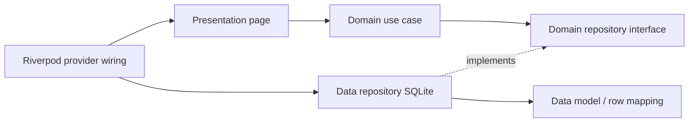

# Week 7 - Clean Architecture

Refactor lanjutan aplikasi catatan offline Week 5 pada repository portfolio yang sama. Perubahan Week 7 sekarang mencakup feature `notes` dengan pemisahan Domain, Data, dan Presentation serta alur CRUD (lihat, tambah, edit, hapus).

## Yang berubah

- Kontrak `NoteRepository` dan entity `Note` berada di Domain.
- `NoteModel` menangani mapping row SQLite; `NoteRepositoryImpl` menangani query, insert, update, dan delete.
- Riverpod menyediakan repository dan use case ke halaman Notes.
- UI mendukung tambah/edit dengan validasi judul, menu aksi per catatan, konfirmasi hapus, error, dan retry.
- Edit mempertahankan `created_at`, memperbarui `updated_at`, dan menandai catatan `dirty`.
- Tidak ada file di luar folder Week 7 yang diubah oleh perubahan ini.

## Struktur dan arah dependensi

```text
lib/
  core/                                  # Failure dan fungsi murni
  features/notes/
    domain/
      entities/note.dart
      failures/failure.dart
      repositories/note_repository.dart # kontrak
      usecases/                          # get, add, update, delete
    data/
      models/note_model.dart             # row <-> entity
      repositories/note_repository_impl.dart
    presentation/
      pages/notes_page.dart
      providers/notes_providers.dart     # Riverpod wiring
```



Presentation bergantung pada kontrak dan use case Domain. Data mengimplementasikan kontrak Domain. Provider di Presentation menjadi composition point dan menghubungkan `openNotesDb` dari package Week 5 ke repository.

## Fitur dan stack

- Flutter, Dart, Material, Riverpod 3, SQLite melalui `sqflite`.
- Daftar Notes, tambah, edit, hapus, tanggal pembaruan, validasi, loading/error, dan retry.
- Halaman Notes dapat dibuka dari action Catatan di layar Profil Mahasiswa melalui route `/notes`.
- Database tetap menggunakan package path lokal Week 5; kode Week 5 tidak disalin atau diubah.

## Dependency rule: tiga pemeriksaan sterilitas

Jalankan dari root repository. Exit code 1 berarti tidak ada match dan pemeriksaan tersebut steril.

```powershell
# 1. Presentation tidak mengakses driver, query database, atau mapping row
rg -n 'package:(sqflite|dio|firebase)|\.query\(|\.insert\(|\.fromMap|toMap\(' 07-week-7-clean-architecture/lib/features/notes/presentation

# 2. Domain tidak mengimpor framework atau detail infrastruktur
rg -n 'package:(flutter|sqflite|dio|firebase)|week5_offline_notes|\.fromMap|toMap\(' 07-week-7-clean-architecture/lib/features/notes/domain

# 3. Entity tidak memuat mapping atau operasi database
rg -n 'fromMap|toMap|\.query\(|\.insert\(' 07-week-7-clean-architecture/lib/features/notes/domain/entities
```

Hasil inspeksi: ketiga pola tidak ditemukan. Mapping `fromMap/toMap` tinggal pada Data model, dan query SQLite tinggal pada Data repository.

## Screenshot

[`screenshots/notes-before.png`](screenshots/notes-before.png) merekam daftar sebelum menu edit/hapus ditambahkan. Belum ada screenshot after: proses `flutter devices` tidak selesai di lingkungan ini. Repo Week 5 juga tidak memiliki gambar baseline; `screenshots/README.md` di sana hanya berisi petunjuk screenshot. Tangkap after dari aplikasi berjalan untuk melengkapi perbandingan visual.

## Menjalankan dan tes

Jalankan dari folder ini:

```bash
flutter pub get
flutter run
flutter analyze
flutter test
```

Tes yang ada mencakup `GetNotes` sukses dan failure dengan fake repository, mapping tanggal model/entity, flow widget CRUD, dan fungsi format/route. Percobaan `flutter test`/`flutter analyze` pada sesi ini tidak menghasilkan output dari proses Flutter/Dart, jadi saya belum dapat mengklaim hasilnya lulus.

## Refleksi

- Interface repository tinggal di Domain agar aturan aplikasi menentukan kontrak data. Jika interface berada di Data, Domain harus bergantung pada detail luar dan pergantian storage menular ke aturan inti.
- Use case berguna saat ada aturan, orkestrasi, atau kebijakan yang ingin diuji terpisah. Untuk operasi satu langkah, repository dari notifier/controller sering cukup.
- Use case satu baris untuk setiap operasi menambah file dan wiring. Untuk tim kecil biayanya sepadan jika boundary tiap aksi membantu testability/aturan, tetapi dapat disederhanakan ke controller saat operasi tetap trivial.
- Usulan AI untuk memindah auth/announcements ditolak karena fitur tersebut bukan sumber refactor Week 5. Scope difokuskan pada Notes yang benar-benar tersedia.

Laporan prompt, tabel usulan vs keputusan akhir, dan alasan teknis ada di [`docs/ai-challenge.md`](docs/ai-challenge.md).
