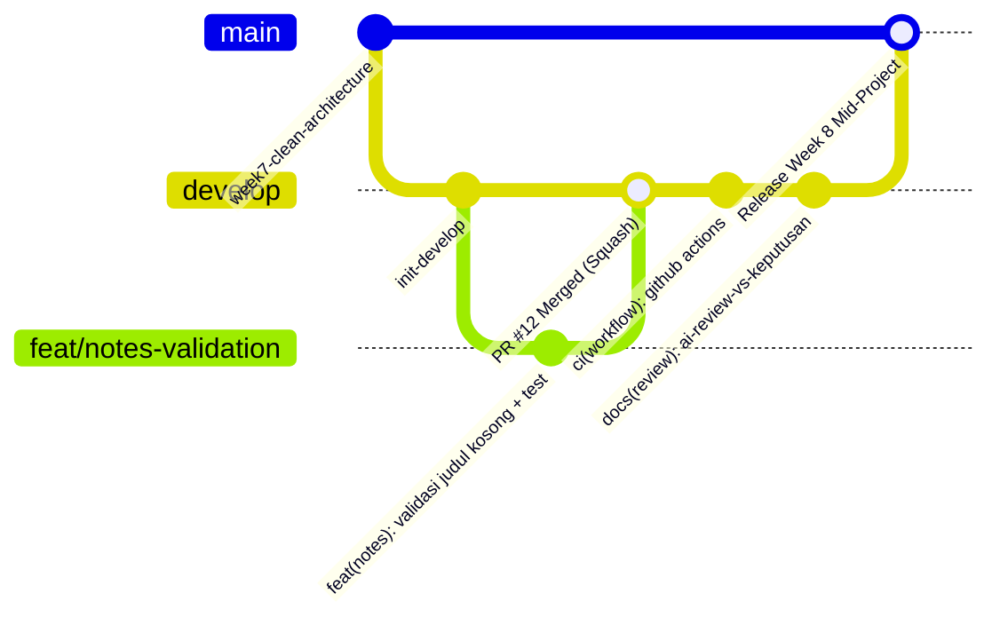

# Week 8 — Mid Project Review & Code Review Portfolio

Dokumentasi portofolio tengah semester (Mid Project Review) untuk mata kuliah **Pemrograman Mobile**. Folder ini merepresentasikan audit mutu perangkat lunak, standardisasi kolaborasi Git Flow, otomatisasi Continuous Integration (CI), peer review terstruktur, dan evaluasi kritis terhadap AI Code Reviewer pada implementasi *Feature-First Clean Architecture*.

---

## 📌 Ringkasan Status Paruh Semester (Mid-Semester Milestone)

* **Mahasiswa**: M. Yahya Irvansyah
* **Mata Kuliah**: Pemrograman Mobile (Semester Genap 2026)
* **Basis Proyek**: Kelanjutan dari Proyek Catatan Offline Minggu 5–7 (*Refactor Clean Architecture*)
* **Status Kesiapan Proyek**: **100% SIAP & LOLOS AUDIT (Ready for H2)**
* **Kualitas Mesin**:
  * `flutter analyze`: **0 issue (Clean)**
  * `dart format`: **100% konsisten (Exit code 0)**
  * `flutter test`: **14 tests passed (100% passing)**
* **Integritas Arsitektur**: **3 Uji Sterilitas Clean Architecture Lolos (Steril)**

---

## 🗺️ Peta Issue dan Pull Request (Git Flow)

Alur branching mengikuti spesifikasi Git Flow profesional:



| ID Referensi | Tipe | Judul / Deskripsi | Branch | Status |
|:------------:|:----:|:------------------|:------:|:------:|
| **Issue #12** | Bug / Enhancement | Catatan dapat tersimpan tanpa judul atau hanya berisi spasi | `develop` | **Closed** (via PR #12) |
| **PR #12** | Pull Request | `feat(notes): validasi judul kosong + test` | `feat/notes-validation` $\rightarrow$ `develop` | **Merged (Approved)** |
| **Commit Standar** | Conventional Commits | Tiga commit lama direfaktor menjadi format konvensional | `develop` | **Terdokumentasi** |

---

## 🏗️ Arsitektur & Aturan Dependensi (*Clean Architecture*)

Proyek menerapkan *Feature-First Clean Architecture* yang ketat dengan aturan ketergantungan mengarah ke dalam (*Dependency Rule*):

```
08-week-8-mid-project-review/
├── .github/
│   └── workflows/
│       └── ci.yml               # Otomatisasi CI (Lint, Format, Test)
├── docs/
│   ├── review-checklist.md      # Audit Git, Tabel Commit, Lembar Peer Review, Sterilitas
│   └── ai-review-vs-keputusan.md # Evaluasi Kritis 5 Temuan AI vs Keputusan Developer
├── screenshots/
│   ├── notes-before.png         # Tampilan awal daftar catatan
│   ├── notes-dialog.png         # Form input & validasi dialog
│   └── notes-list.png           # Daftar catatan dengan status update
├── lib/
│   ├── core/                    # Abstraksi DB SQLite, Format util, Provider dasar
│   │   ├── database/notes_db.dart
│   │   ├── format.dart
│   │   └── providers.dart
│   ├── features/
│   │   └── notes/
│   │       ├── domain/          # Pure Dart: Entities, Failure, Contract, Use Cases
│   │       │   ├── entities/note.dart
│   │       │   ├── failures/failure.dart
│   │       │   ├── repositories/note_repository.dart
│   │       │   └── usecases/    # get, add, update, delete (with validation)
│   │       ├── data/            # SQLite Implementation, Model, Row Mapping
│   │       │   ├── models/note_model.dart
│   │       │   └── repositories/note_repository_impl.dart
│   │       └── presentation/    # UI Widgets, Pages, Riverpod Providers
│   │           ├── pages/notes_page.dart
│   │           └── providers/notes_providers.dart
│   ├── main.dart
│   └── routes.dart
└── test/
    ├── core/format_test.dart
    ├── features/notes/notes_page_test.dart
    ├── get_notes_test.dart
    └── validate_note_test.dart  # 5 Unit test validasi input invariant
```

### Bukti Tiga Pengujian Sterilitas Arsitektur

Dijalankan dari root repository:
```bash
# 1. Presentation steril dari driver database / query SQLite biner
git grep -E "package:sqflite|package:dio|\.query\(|\.insert\(|\.fromMap|toMap\(" -- 08-week-8-mid-project-review/lib/features/notes/presentation
# Hasil: Exit code 1 (Steril!)

# 2. Domain steril dari framework Flutter, UI, atau package eksternal
git grep -E "package:flutter/|package:sqflite|package:dio" -- 08-week-8-mid-project-review/lib/features/notes/domain
# Hasil: Exit code 1 (Steril!)

# 3. Data steril dari layer Presentation
git grep -E "presentation/" -- 08-week-8-mid-project-review/lib/features/notes/data
# Hasil: Exit code 1 (Steril!)
```

---

## 🛠️ Stack Teknologi

* **Framework**: Flutter SDK (v3.14+) / Dart
* **Architecture Pattern**: Feature-First Clean Architecture (Domain $\leftarrow$ Data & Presentation)
* **State Management**: Flutter Riverpod (`flutter_riverpod: ^3.4.3`)
* **Local Persistence**: SQLite via `sqflite: ^2.4.4` & `path: ^1.9.1`
* **Static Analysis**: `flutter_lints: ^6.0.0`
* **Testing**: `flutter_test` (Unit Test, Mock Repository, Widget Test)
* **CI Automation**: GitHub Actions (`.github/workflows/ci.yml`)

---

## 🧪 Verifikasi Mutu dan Otomatisasi Mesin

Setiap perubahan diuji menggunakan *quality gate* mesin sebelum di-review manusia:

### 1. Static Analysis (`flutter analyze`)
```text
Analyzing 08-week-8-mid-project-review...
No issues found! (ran in 25.5s)
```

### 2. Formatter Kebersihan Kode (`dart format`)
```bash
dart format --output=none --set-exit-if-changed .
# Output: Formatted 21 files (0 changed) in 0.17 seconds. (Exit Code 0)
```

### 3. Otomatisasi Unit & Widget Test (`flutter test`)
```text
00:00 +1: formatDate returns a zero-padded date
00:00 +2: parseRoute returns the URI path without query or fragment
00:00 +3: parseRoute returns null for a missing route
00:01 +4: test/features/notes/notes_page_test.dart: reads notes and completes the Notes CRUD flow
00:00 +10: test/validate_note_test.dart: AddNote gagal saat judul string kosong
00:00 +11: test/validate_note_test.dart: AddNote gagal saat judul whitespace
00:00 +12: test/validate_note_test.dart: AddNote sukses saat judul valid
00:00 +13: test/validate_note_test.dart: UpdateNote gagal saat judul kosong
00:00 +14: test/validate_note_test.dart: UpdateNote sukses saat judul valid
00:09 +14: All tests passed!
```

---

## 👥 Ringkasan Peer Review & AI Review Verification

1. **Peer Review Sejawat**:
   * Menghasilkan 4 temuan berformat **Observasi $\rightarrow$ Dampak $\rightarrow$ Usulan Konkret**:
     * Edge case spasi putih (*whitespace*) pada form catatan.
     * Penanganan error path pada edit/update catatan kosong.
     * Pemisahan koneksi SQLite ke abstraction helper.
     * Penambahan negative tests untuk kasus regresi.
   * Status: **Seluruhnya diperbaiki, diverifikasi ulang, dan Approved**.
2. **AI Review Challenge (`docs/ai-review-vs-keputusan.md`)**:
   * **3 Temuan AI Diterima**: Validasi whitespace, pengecekan *rows affected* pada SQLite update, dan unit test negative cases.
   * **2 Temuan AI Ditolak**:
     * **Penolakan 1 (Fatal)**: Menolak usulan AI yang ingin mengimpor `BuildContext` dan `go_router` ke dalam Domain Use Case karena melanggar keras *Clean Architecture Dependency Rule*.
     * **Penolakan 2 (Halusinasi)**: Menolak tuduhan AI bahwa Riverpod `FutureProvider` menyebabkan memory leak dan menolak memaksakan boilerplate `StatefulWidget`.

---

## 🚀 Panduan Menjalankan Aplikasi & Pengujian

### Prasyarat
* Flutter SDK (3.14.0 atau terbaru)
* Android Device / Emulator / Windows Desktop

### Langkah Menjalankan
```bash
# 1. Pindah ke direktori Week 8
cd 08-week-8-mid-project-review

# 2. Ambil dependensi
flutter pub get

# 3. Jalankan pengujian statis dan unit test
flutter analyze
dart format --set-exit-if-changed .
flutter test

# 4. Jalankan aplikasi pada perangkat
flutter run
```

### Langkah Pengujian Manual (5 Menit)
1. Buka aplikasi $\rightarrow$ Pada halaman Profil Mahasiswa, klik icon Catatan di AppBar.
2. Klik tombol `+` (Tambah Catatan).
3. **Uji Validasi**: Kosongkan judul atau masukkan spasi saja `"   "` lalu tekan Simpan.
   * *Hasil yang diharapkan*: Muncul validasi "Judul wajib diisi" dan dialog tidak tertutup.
4. Masukkan judul `"Materi Minggu 8"` dan isi `"Mid Project Review"`, lalu tekan Simpan.
   * *Hasil yang diharapkan*: Catatan baru muncul di daftar paling atas.
5. Klik menu opsi pada catatan $\rightarrow$ Edit Catatan $\rightarrow$ Ubah judul menjadi kosong $\rightarrow$ Simpan.
   * *Hasil yang diharapkan*: Validasi mencegah update kosong.
6. Hapus catatan dengan konfirmasi dialog $\rightarrow$ Catatan terhapus dari SQLite.

---

## 📸 Dokumentasi Antarmuka (Screenshots)

| Layar Catatan Awal | Dialog Input & Validasi | Daftar Catatan Terkini |
|:---:|:---:|:---:|
|  |  |  |

---

## ⚠️ Error Umum dan Solusinya

| Gejala Masalah | Penyebab Umum | Solusi yang Diterapkan |
|:---|:---|:---|
| PR ratusan baris tak kunjung direview | Menggabungkan terlalu banyak fitur dalam 1 PR | Pecah per fitur logis; pastikan PR berukuran `< 300` baris. |
| Konflik merge berulang (*merge conflict*) | Branch berumur panjang dan jarang sinkron | Lakukan pull/rebase harian dari `develop`; jaga umur branch `< 3` hari. |
| Review hanya memperdebatkan gaya spasi/indentasi | Tidak adanya linter dan formatter otomatis | Terapkan `dart format` terotomatisasi dan pasang CI blocker. |
| Status Approve tetapi bug lolos ke lini produksi | Reviewer hanya melihat diff tanpa checkout & test | Wajibkan reviewer checkout branch, jalankan `flutter test`, dan uji manual. |
| Saran AI merusak struktur Clean Architecture | Menerima kode AI secara mentah tanpa verifikasi | Verifikasi dependensi, tolak import UI di domain, dan buktikan dengan test. |

---

## 💡 Refleksi Pembelajaran (Mid-Project Review)

Dokumentasi refleksi menyeluruh atas praktik peer review, audit arsitektur, dan evaluasi AI:

### 1. Apa beda LGTM buta dengan approve yang bertanggung jawab? Apa risikonya bagi tim?
* **LGTM Buta (*Rubber-Stamp Review*)**: Memberikan persetujuan (*Approve*) secara instan hanya berdasarkan judul PR, deskripsi, atau checklist CI tanpa membaca baris kode (*diff*), tanpa memeriksa implikasi arsitektur, dan tanpa melakukan checkout branch untuk memverifikasi fungsionalitas secara lokal.
* **Approve yang Bertanggung Jawab**: Meninjau kebenaran logika baris demi baris, memverifikasi penanganan *edge cases* (seperti sanitasi *whitespace* dan penanganan status error), memastikan *Clean Architecture Dependency Rule* tidak dilanggar, memastikan ketersediaan pengujian otomatis (*unit & widget tests*), serta memastikan kode lolos analisis statis (`flutter analyze`) dan format resmi (`dart format`).
* **Risiko bagi Tim**:
  * **Kebocoran Bug & Regresi ke Produksi**: Cacat fungsional yang lolos dari review akan langsung dirasakan pengguna akhir di lini produksi.
  * **Erosi Arsitektur & Akumulasi Technical Debt**: Masuknya kode instan atau dependensi terlarang (misal UI masuk ke domain) membuat kode sulit di-maintain dan mahal untuk di-refactor di masa mendatang.
  * **Rasa Aman Semu (*False Sense of Security*)**: Tim merasa aman karena ada alur Pull Request, padahal kualitas perangkat lunak tidak tersaring dengan benar.

### 2. Kapan komentar wajib berstatus request changes, dan kapan cukup saran?
* **Wajib Berstatus `Request Changes` (Blocker / Wajib Diperbaiki)**:
  * **Cacat Logika & Kebenaran Data**: Ditemukan bug yang merusak fungsi atau mengorup persistensi data (misal catatan dapat tersimpan hanya dengan spasi tanpa judul).
  * **Pelanggaran Arsitektur**: Terjadi kebocoran layer (misal mengimpor `flutter/material.dart` atau query database di dalam domain use case).
  * **Kegagalan Quality Gate**: Analisis statis gagal (`flutter analyze` ada error/lint) atau *automated tests* gagal (*red CI*).
  * **Keamanan & Performa Fatal**: Kebocoran kredensial atau *memory leak* terbukti pada alokasi resource.
  * **Ketiadaan Test**: Fitur baru krusial dimasukkan tanpa menyertakan unit test pendukung.
* **Cukup Berstatus Saran / Nitpick (`Comment` / Non-blocking)**:
  * Rekomendasi penamaan variabel yang lebih ekspresif selama nama awal tidak menimbulkan ambiguitas.
  * Saran pemanfaatan fitur bahasa modern (misal Dart 3 pattern matching / switch expression) yang tidak memengaruhi logika bisnis.
  * Optimasi mikro yang belum terbukti menjadi bottleneck performa.
  * Perbaikan minor pada typo komentar/dokumentasi atau pemformatan teks pesan commit.

### 3. Bagian mana dari review AI yang Anda tolak atau sederhanakan, dan mengapa?
* **Usulan AI yang DITOLAK KERAS**:
  * **Temuan AI #2 (Inject `BuildContext` & SnackBar ke Domain)**: AI menyarankan agar domain usecase `AddNote` langsung mengimpor `package:flutter/material.dart` dan `package:go_router/go_router.dart` untuk menampilkan notifikasi UI dan menutup dialog.  
    * *Alasan Penolakan*: **Pelanggaran fatal Clean Architecture Dependency Rule!** Domain harus murni Dart (*pure Dart*). Mengikat usecase ke framework UI menghancurkan portabilitas, mempersulit unit test headless, dan merusak decoupling.
  * **Temuan AI #5 (Tuduhan Memory Leak & Memaksa StatefulWidget)**: AI menuduh bahwa Riverpod `FutureProvider` menyebabkan memory leak dan mendesak refactor ke `StatefulWidget` dengan manual stream subscription controller.  
    * *Alasan Penolakan*: **Halusinasi AI.** Riverpod secara deklaratif mengelola lifecycle dan auto-dispose provider melalui `ref.watch()`. Memaksakan stateful controller manual adalah *premature optimization* dan anti-pattern.
* **Usulan AI yang DITERIMA & DITINDAKLANJUTI**:
  * **Temuan AI #1 (Sanitasi Whitespace)**: Penggunaan `title.trim().isEmpty` diterapkan untuk memastikan invariant bisnis terjaga.
  * **Temuan AI #3 (Pengecekan Rows Affected)**: Memastikan hasil update SQLite diverifikasi agar tidak menganggap sukses jika record target hilang.
  * **Temuan AI #4 (Negative Test Suite)**: Menambahkan 5 skenario kegagalan validasi pada `test/validate_note_test.dart`.

### 4. Satu hal konkret yang Anda perbaiki setelah review sejawat — apa dampaknya?
* **Hal Konkret yang Diperbaiki**:  
  Menerapkan validasi sanitasi input berbasis invariant di Domain Use Case (`AddNote` dan `UpdateNote`) menggunakan `title.trim().isEmpty`, mengembalikan `ValidationFailure` terstruktur bila tidak valid, serta melengkapinya dengan 5 skenario automated unit test di `test/validate_note_test.dart`.
* **Dampaknya**:
  * **Integritas Database**: Tidak ada lagi catatan "hantu" tanpa judul yang lolos ke database SQLite lokal.
  * **Kejelasan Error di UI**: Lapisan presentasi menerima pesan kesalahan spesifik (`ValidationFailure('Judul tidak boleh kosong')`) sehingga dapat memunculkan feedback instan kepada user sebelum query diproses.
  * **Jaminan Regresi Hijau**: Kode terverifikasi steril dengan 14 automated tests passed dan `flutter analyze` 0 issues, memberikan keyakinan tinggi saat integrasi ke branch `develop`.

---

## 🏁 Kesimpulan

Melalui pelaksanaan Codelab Minggu 8 ini, proyek portofolio paruh semester telah memenuhi standar industri perangkat lunak modern:
1. **Branching & Commit**: Higienis, teratur, dan terlacak melalui *Conventional Commits*.
2. **Kualitas Kode**: Bersih dari error analisis statis (`0 issues`), terformat rapi, dan teruji oleh 14 unit & widget test.
3. **Kemandirian Arsitektur**: Struktur Clean Architecture terbukti steril dari kebocoran abstraksi layer.
4. **Disiplin Kolaborasi**: Menggabungkan ketelitian peer review manusia dengan verifikasi kritis terhadap saran AI. Proyek siap dilanjutkan ke paruh semester kedua.
