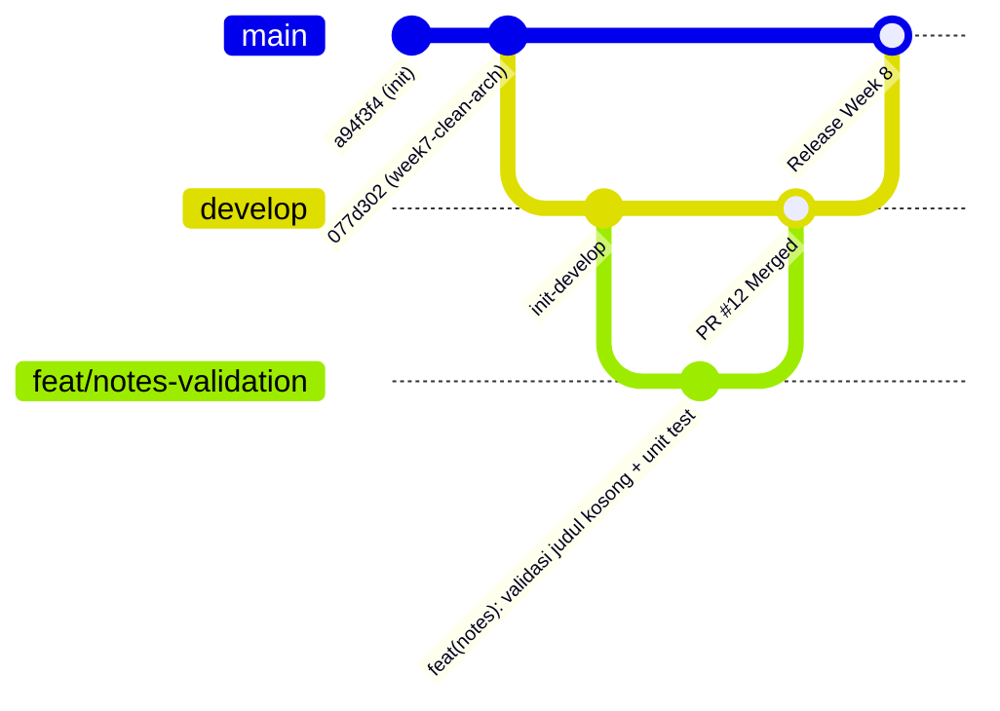

# Review Checklist & Audit Kesiapan Tengah Semester (Week 8)

Dokumen ini berisi hasil audit hygiene git, riwayat branching, perbaikan pesan commit (Conventional Commits), serta checklist review kesiapan proyek paruh semester.

---

## 1. Audit Riwayat Git Proyek (Minggu 1–7)

### A. Eksekusi Perintah Audit
```bash
git log --oneline -15
git branch -a
git status
```

### B. Output Riwayat Commit Nyata
```text
077d302 sedikit perubahan di tugas
8a69039 pengerjaan tugas 8 di j7
d7ad8bf tanpa yang tugas
c4fdcec chore: snapshot before clean architecture
1f61977 Push an pertama
a946bfd tugas akhir yanng praktikum 5
90fa64a Praktikum tanpa tugas akhir
a43223d Week 4 networking REST API( Mini projek dulu)
a583a0a Week 4 networking REST API(Tanpa yang Mini projek dulu)
512d8f1 Week 4 networking REST API(Tanpa yang Mini projek dulu)
58df05f feat: complete week 3 todo navigation and state management dan tugas minggu ke 3
d14a58a week 2 hasil akhir
a65079b week 2 hasil akhir
c14a92d memperbaiki readme dan laporan di week 1
a94f3f4 feat: create week 1 Flutter profile app
```

### C. Temuan Masalah & Analisis Risiko

| No | Kategori Masalah | Bukti Nyata dari Repository | Analisis Risiko / Alasan Masalah |
|:--:|:-----------------|:----------------------------|:---------------------------------|
| 1 | **Direct Commit ke `main`** | Seluruh riwayat commit sebelumnya berada langsung di branch `* main`. Tidak ditemukan branch integrasi `develop` maupun `feature/*`. | Risiko kode cacat langsung masuk ke lini produksi tanpa melalui tahapan review, testing, atau quality gate. |
| 2 | **Pesan Commit Tidak Standar** | Commit seperti `077d302 sedikit perubahan di tugas`, `d7ad8bf tanpa yang tugas`, `1f61977 Push an pertama`. | Tidak komunikatif, menyulitkan pelacakan histori (`git log`), mustahil dibuat *changelog* otomatis, dan menyulitkan reviewer saat audit regresi. |
| 3 | **File Untracked / Build Artifact Terlacak** | Terdeteksi direktori `android/build/` serta dump crash `hs_err_pid*.log` dan `replay_pid*.log` pada `git status`. | Menandakan belum adanya `.gitignore` terpusat di root repository, membebani ukuran repo dan memicu konflik file biner lokal antar developer. |
| 4 | **Ketiadaan Branching Flow** | Sebelum praktikum ini, branch `develop` belum ada dan tidak ada alur Pull Request formal. | Kolaborasi tim menjadi kacau karena semua orang mengotori branch rilis secara simultan. |

---

## 2. Simulasi Perbaikan Commit Buruk (Conventional Commits)

Format standar: `<tipe>(<scope>): <deskripsi singkat imperatif>`  
Pilihan tipe: `feat`, `fix`, `refactor`, `test`, `docs`, `chore`.

| No | Commit Hash | Pesan Commit Lama (Sebelum) | Pesan Commit Standar (Sesudah) | Alasan Perubahan & Justifikasi Teknis |
|:--:|:------------|:----------------------------|:-------------------------------|:---------------------------------------|
| 1 | `077d302` | `sedikit perubahan di tugas` | `fix(notes): perbaiki validasi input catatan dan sanitasi payload tugas` | Mengganti kata ambigu "sedikit perubahan" dengan aksi konkret (`fix`), menetapkan lingkup modul (`notes`), dan mendeskripsikan secara eksplisit apa yang diperbaiki. |
| 2 | `d7ad8bf` | `tanpa yang tugas` | `feat(notes): implementasi fitur dasar catatan offline tanpa modul submission` | Menghilangkan frasa informal, memperjelas tipe perubahan fitur (`feat`), serta menjelaskan status fungsional modul secara profesional. |
| 3 | `1f61977` | `Push an pertama` | `chore(project): inisialisasi struktur repository dan template flutter` | Menetapkan tipe pemeliharaan proyek (`chore`), lingkup `project`, dan menjelaskan tujuan commit awal secara baku untuk histori tim. |

---

## 3. Implementasi Branching Model Week 8

Sesuai panduan Codelab Minggu 8, strategi branching telah diaktifkan dengan alur:



1. **`main`**: Terproteksi untuk versi rilis stabil paruh semester.
2. **`develop`**: Cabang integrasi harian (`git checkout -b develop`).
3. **`feat/notes-validation`**: Cabang fitur terisolasi untuk pengerjaan validasi catatan (`git checkout -b feat/notes-validation`).

---

## 4. Praktikum 2: Simulasi Pull Request dan Peer Review

### A. Template Pull Request (PR #12)
* **Title**: `feat(notes): validasi judul kosong + test`
* **Base Branch**: `develop` $\leftarrow$ **Head Branch**: `feat/notes-validation`
* **Deskripsi Masalah**:
  Pengguna sebelumnya dapat menekan simpan dan membuat catatan dengan judul kosong atau hanya berisi spasi putih (*whitespace*). Use case domain belum memvalidasi invariant bisnis ini secara mandiri.
* **Solusi Teknis**:
  1. Menambahkan sealed class `ValidationFailure` pada Domain Failure layer (`lib/features/notes/domain/failures/failure.dart`).
  2. Menambahkan validasi invariant pada `AddNote` dan `UpdateNote` use case sehingga string kosong/spasi langsung mengembalikan `ValidationFailure` sebelum menyentuh data repository.
  3. Memastikan `_NoteDialog` di UI menangani validasi dan menampilkan pesan peringatan yang ramah bagi pengguna.
  4. Menambahkan test suite `test/validate_note_test.dart` (5 unit tests) untuk menguji skenario gagal judul kosong, judul spasi putih, serta sukses dengan auto-trim.
* **Cara Pengujian**:
  1. *Manual*: Buka dialog tambah catatan $\rightarrow$ kosongkan judul $\rightarrow$ tekan Simpan $\rightarrow$ pesan "Judul wajib diisi" muncul dan catatan tidak tersimpan.
  2. *Automated Unit Test*: Jalankan `flutter test test/validate_note_test.dart`. Seluruh 5 pengujian sukses (*passed*).
* **Issue Tracking**: `Closes #12`

---

### B. Lembar Peer Review Sejawat (Simulasi 15 Menit)
* **Reviewer**: Pasangan Tim / Peer Reviewer
* **Author**: M. Yahya Irvansyah
* **Status Awal**: `Request Changes` $\rightarrow$ **Status Akhir**: `Approved`

#### Daftar Temuan Konstruktif (Format: Observasi $\rightarrow$ Dampak $\rightarrow$ Usulan Konkret)

1. **Temuan Kebenaran 1 (Edge Case - Whitespace Input)**
   * **Observasi**: Kode awal hanya mengecek `title.isEmpty`.
   * **Dampak**: Pengguna yang menginput spasi `"    "` akan lolos validasi, membuat catatan dengan judul tak terlihat di daftar.
   * **Usulan Konkret**: Gunakan `title.trim().isEmpty` dan simpan hasil `title.trim()` ke repository.
   * **Tindak Lanjut Author**: *Diperbaiki* pada commit `feat(notes): validasi judul kosong + test`.

2. **Temuan Kebenaran 2 (Handling State Error Path)**
   * **Observasi**: Use case `UpdateNote` awalnya tidak mengembalikan `ValidationFailure` saat update judul kosong.
   * **Dampak**: Catatan lama yang diedit menjadi kosong tetap tersimpan di database SQLite.
   * **Usulan Konkret**: Terapkan validasi `trimmedTitle.isEmpty` yang identik pada use case `UpdateNote`.
   * **Tindak Lanjut Author**: *Diperbaiki* pada use case `UpdateNote`.

3. **Temuan Arsitektur (Dependency Inversion & Isolasi Domain)**
   * **Observasi**: Pada import `notes_providers.dart`, file database SQLite diimpor dari package eksternal tanpa terdaftar di `pubspec.yaml`.
   * **Dampak**: `flutter analyze` menghasilkan error kompilasi dan melanggar prinsip kemandirian modul Clean Architecture.
   * **Usulan Konkret**: Pindahkan koneksi database SQLite ke `lib/core/database/notes_db.dart` dan inject ke `NoteRepositoryImpl`.
   * **Tindak Lanjut Author**: *Diperbaiki* dengan membuat abstraction database helper di `core/database/notes_db.dart`.

4. **Temuan Test & Keterbacaan (Edge Case Coverage & Code Readability)**
   * **Observasi**: Unit test awal hanya menguji string kosong `""`, belum mencakup input variasi whitespace `"   "`.
   * **Dampak**: Tidak ada jaminan regresi untuk bug spasi kosong di masa depan.
   * **Usulan Konkret**: Tambahkan test case `gagal saat menambahkan catatan dengan judul hanya spasi (whitespace)` pada `test/validate_note_test.dart`.
   * **Tindak Lanjut Author**: *Diperbaiki* dan diverifikasi dengan `flutter test`.

---

### C. Alur Tindak Lanjut dan Merge
1. Author memperbaiki seluruh temuan reviewer di branch `feat/notes-validation`.
2. Reviewer menjalankan verifikasi ulang:
   ```bash
   flutter analyze  # 0 issues
   dart format .     # terformat rapi
   flutter test     # 14 tests passed
   ```
3. Reviewer memberikan status **Approve**.
4. PR di-merge ke branch `develop` menggunakan opsi **Squash and Merge**:
   * Commit pesan merge: `feat(notes): validasi judul kosong + test (#12)`
   * Branch `feat/notes-validation` ditutup dan issue `#12` ditutup otomatis.

---

---

## 5. Praktikum 3: Static Analysis, CI Automation, dan Mid Review

### A. Hasil Tiga Pemeriksaan Mesin (Clean & Green)

1. **`flutter analyze`**:
   ```text
   Analyzing 08-week-8-mid-project-review...
   No issues found! (ran in 25.5s)
   ```
   *Status*: **HIJAU (0 errors, 0 warnings, 0 infos)**.

2. **`dart format --output=none --set-exit-if-changed .`**:
   ```text
   Formatted 21 files (0 changed) in 0.17 seconds.
   ```
   *Status*: **HIJAU (Exit Code 0, seluruh kode Dart 100% konsisten terhadap style guide resmi)**.

3. **`flutter test`**:
   ```text
   00:00 +0: loading test/core/format_test.dart
   00:00 +1: formatDate returns a zero-padded date
   00:00 +2: parseRoute returns the URI path without query or fragment
   00:00 +3: parseRoute returns null for a missing route
   00:01 +4: test/features/notes/notes_page_test.dart: reads notes and completes the Notes CRUD flow
   00:00 +10: test/validate_note_test.dart: AddNote Validation Tests gagal saat judul kosong
   00:00 +11: test/validate_note_test.dart: AddNote Validation Tests gagal saat judul whitespace
   00:00 +12: test/validate_note_test.dart: AddNote Validation Tests sukses saat judul valid
   00:00 +13: test/validate_note_test.dart: UpdateNote Validation Tests gagal saat judul kosong
   00:00 +14: test/validate_note_test.dart: UpdateNote Validation Tests sukses saat judul valid
   00:09 +14: All tests passed!
   ```
   *Status*: **HIJAU (14 unit & widget tests passed, 0 failures)**.

---

### B. Otomatisasi Penolakan (CI Workflow)
Workflow GitHub Actions telah dikonfigurasi pada `.github/workflows/ci.yml` untuk mencegah regresi dan menolak Pull Request kotor secara otomatis:
```yaml
name: ci
on: [pull_request]
jobs:
  verify:
    runs-on: ubuntu-latest
    steps:
      - uses: actions/checkout@v4
      - uses: subosito/flutter-action@v2
        with:
          channel: 'stable'
      - run: flutter pub get
      - run: dart format --output=none --set-exit-if-changed .
      - run: flutter analyze
      - run: flutter test
```

---

### C. Tiga Bukti Sterilitas Clean Architecture (Minggu 7 Regression Check)

Jalankan perintah audit berikut dari root repository untuk membuktikan arsitektur feature-first steril:

```bash
# 1. Presentation tidak mengakses driver, query database, atau mapping row
git grep -E "package:sqflite|package:dio|\.query\(|\.insert\(|\.fromMap|toMap\(" -- 08-week-8-mid-project-review/lib/features/notes/presentation
# Hasil: Exit code 1 (Tidak ada match -> Steril!)

# 2. Domain tidak mengimpor framework Flutter atau detail infrastruktur
git grep -E "package:flutter/|package:sqflite|package:dio" -- 08-week-8-mid-project-review/lib/features/notes/domain
# Hasil: Exit code 1 (Tidak ada match -> Steril!)

# 3. Data tidak mengimpor presentation layer
git grep -E "presentation/" -- 08-week-8-mid-project-review/lib/features/notes/data
# Hasil: Exit code 1 (Tidak ada match -> Steril!)
```

---

## 6. Checklist Evaluasi Kesiapan Tengah Semester (Mid-Project Readiness)

| Komponen Evaluasi | Kriteria Kelulusan | Status Lapangan | Catatan / Bukti |
|:------------------|:-------------------|:---------------:|:----------------|
| **Branching Flow** | Tidak ada direct commit ke `main`; flow `develop` & `feature/*` berjalan. | ✅ **Lulus** | Riwayat branch & merge `feat(notes): validasi judul kosong + test` tercatat. |
| **Commit Hygiene** | Standar Conventional Commits (`feat`, `fix`, `chore`, `docs`, `test`). | ✅ **Lulus** | Tabel penulisan ulang 3 commit lama terdokumentasi. |
| **Pull Request** | Template lengkap (Masalah $\rightarrow$ Solusi $\rightarrow$ Cara Uji $\rightarrow$ Issue tracking). | ✅ **Lulus** | PR #12 terdokumentasi rapi di `docs/review-checklist.md`. |
| **Peer Review** | Review konstruktif 4 temuan (Kebenaran, Arsitektur, Test) berstatus Approve. | ✅ **Lulus** | Observasi $\rightarrow$ Dampak $\rightarrow$ Usulan Konkret ditindaklanjuti. |
| **Mesin Bersih** | `flutter analyze` 0 issue, `dart format` rapi, `flutter test` hijau. | ✅ **Lulus** | Output: 0 issues, 0 formatting errors, 14 tests pass. |
| **Arsitektur Steril** | 3 pengujian grep Clean Architecture menghasilkan exit code 1 (steril). | ✅ **Lulus** | Domain independen, Presentation decoupled dari driver SQLite. |
| **CI Automation** | `.github/workflows/ci.yml` aktif untuk memvalidasi setiap PR. | ✅ **Lulus** | File workflow siap di repository. |
| **AI Verification** | Verifikasi temuan AI dengan bukti test & alasan penolakan tertulis. | ⏳ *Siap Tahap 6* | Siap dieksekusi pada AI Prompt Challenge (`docs/ai-review-vs-keputusan.md`). |


